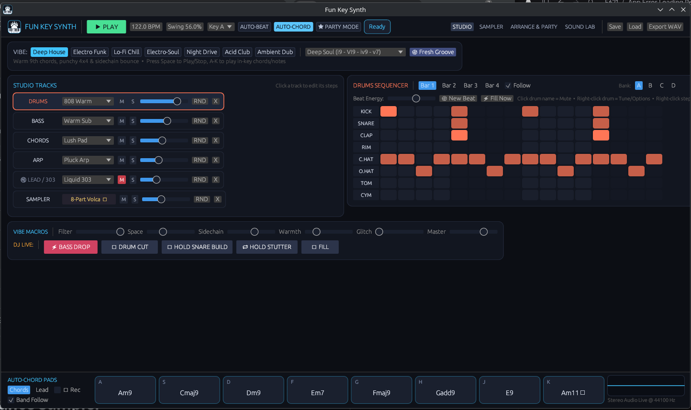
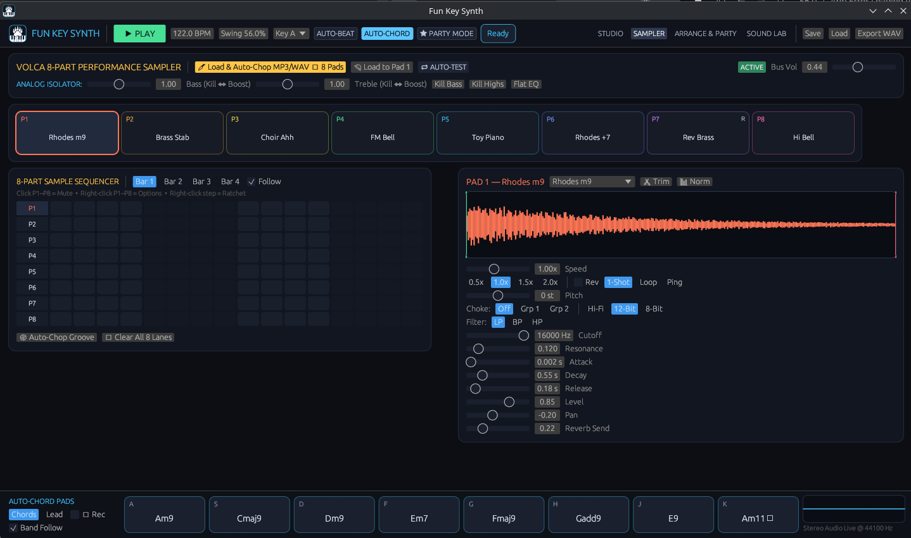
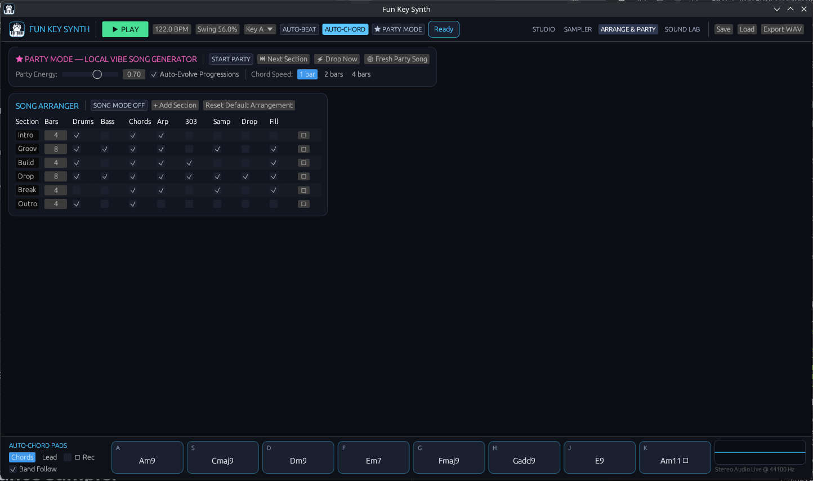
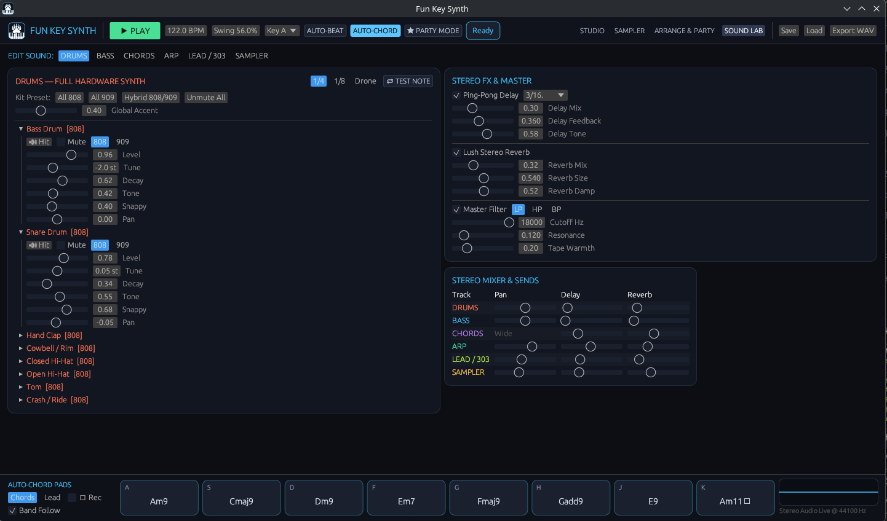

<p align="center">
  
</p>

<h1 align="center">Fun Key Synth</h1>

<p align="center">
  <strong>A beginner-friendly analog vibe studio, Auto-Chord / Auto-Beat groovebox, local Party Mode song generator, and Volca-style 8-part performance sampler — built in Rust.</strong>
</p>

<p align="center">
  <a href="https://github.com/morganlowe/fun-key-synth/releases/latest"><strong>⬇ Download Latest Release (v1.3.1)</strong></a>
  &nbsp;·&nbsp;
  <a href="#visual-tour">Screenshots</a>
  &nbsp;·&nbsp;
  <a href="#what-it-does">What It Does</a>
  &nbsp;·&nbsp;
  <a href="#how-it-works">How It Works</a>
  &nbsp;·&nbsp;
  <a href="#controls--shortcuts">Controls</a>
  &nbsp;·&nbsp;
  <a href="#installation">Install</a>
</p>

---

## What Is Fun Key Synth?

**Fun Key Synth** is a standalone desktop music studio designed to make creating electronic tracks feel **immediate, musical, and fun** — whether you have never touched a synthesizer before or you love tweaking analog filters and chopping samples.

Most DAWs and grooveboxes bury beginners under empty timelines, raw MIDI numbers, and 50 unlabeled knobs. Fun Key Synth flips that around:

- **Start in a Vibe, Not a Blank Screen:** Pick one of **7 curated musical vibes** (*Deep House, Heavy Electro Funk, Lo-Fi Chill, Electro-Soul, Night Drive, Acid Club, Ambient Dub*) and press **`Space`**. You immediately have a balanced, true-stereo, sidechained groove playing in real time.
- **Impossible to Hit a Wrong Note:** Turn on **Auto-Chord** and press any key from **`A` to `K`** to play lush, voice-led 7th/9th/11th chords in key — and with **Band Follow**, the Bass and Arp automatically lock to the chords you play live.
- **100% Local & Real-Time:** Every synth voice, drum hit, reverb tail, sample chop, and **Party Mode** song arrangement is synthesized locally on your CPU with zero cloud APIs, zero subscriptions, and zero latency bloat.
- **Beginner-Friendly on Top, Deep Hardware Under the Hood:** Stay on the main **Studio** screen for 1-click presets and Vibe Macros, or dive into the **8-Part Volca Sampler** and **Sound Lab** whenever you want to sculpt 3-oscillator Moog patches, sync/ring-mod Monologue leads, 303 acid lines, or individual 808/909 drum voices.

---

## Installation

Prebuilt packages for **Debian/Ubuntu (`.deb`)**, **Fedora / RHEL / openSUSE (`.rpm`)**, **Arch Linux / CachyOS (`.pkg.tar.zst`)**, **Windows (`.zip`)**, and **Generic Linux (`.tar.gz`)** are available on the **[GitHub Releases](https://github.com/morganlowe/fun-key-synth/releases/latest)** page.

- **Download & full release notes:** [github.com/morganlowe/fun-key-synth/releases](https://github.com/morganlowe/fun-key-synth/releases/latest)
- **Debian / Ubuntu:** `sudo apt install ./fun-key-synth_1.3.1_amd64.deb`
- **Fedora / RHEL / openSUSE:** `sudo dnf install ./fun-key-synth-1.3.1-1.x86_64.rpm` (or `sudo zypper install ./fun-key-synth-1.3.1-1.x86_64.rpm`)
- **Arch / CachyOS:** `sudo pacman -U fun-key-synth-1.3.1-1-x86_64.pkg.tar.zst`
- **Windows:** Unzip `fun-key-synth-v1.3.1-windows-x86_64.zip` and run `fun-key-synth.exe`
- **Generic Linux:** Extract `fun-key-synth-v1.3.1-linux-x86_64.tar.gz` and run `./fun-key-synth`

<details>
<summary><strong>Building from source (Rust / Cargo)</strong></summary>

Install the Rust toolchain (`rustup`) and, on Linux, ALSA + Wayland/X11 development libraries (`alsa-lib` / `libasound2-dev`), then run:

```sh
git clone https://github.com/morganlowe/fun-key-synth.git
cd fun-key-synth
cargo run --release
```

To run the audio engine unit tests (which render stereo buffers across all 7 vibes and Party Mode and verify zero NaNs or hard clipping):

```sh
cargo test --release
```

</details>

---

## Visual Tour

Fun Key Synth is organized into **four clean workspaces** accessible from the top bar, with the **Playable Auto-Chord / Scale Pads (`A`–`K`)** always docked at the bottom so you can jam from anywhere.

### 1. Studio — Vibe Picker, 6 Tracks, Sequencer, Macros & Live DJ Deck

Everything you need to build a track on one screen: pick a **Vibe**, switch chord progressions, tweak your 6 role-named tracks (`DRUMS`, `BASS`, `CHORDS`, `ARP`, `LEAD / 303`, `SAMPLER`), edit 64-step (4-bar) patterns, sweep **Vibe Macros**, fire live **DJ buttons** (`BASS DROP`, `DRUM CUT`, `HOLD SNARE BUILD`, `HOLD STUTTER`, `FILL`), and play live chords on `A`–`K`.

### 2. Sampler — Volca-Style 8-Part Performance Sampler

Inspired by the **Korg Volca Sample 2**: load **MP3, WAV, FLAC, or OGG** files onto any of 8 independent pads — or hit **Load & Auto-Chop** to slice a track evenly across all 8 pads with Choke Groups — then sequence all 8 lanes (`P1`–`P8`), drag **Start / End** handles on the live waveform, adjust **Speed (`0.25x–2.0x`)**, and perform live with the **Bass / Treble Analog Isolator**.

### 3. Arrange & Party — Local Song Generator & Section Arranger

Flip on **Party Mode** to let Fun Key Synth act as a local live DJ/producer — automatically evolving your Vibe through *Intro → Groove → Build → Drop 1 → Break → Drop 2* with filter sweeps, snare builds, and key-locked bass drops — or customize your own section-by-section **Song Arranger** with simple track checkboxes.

### 4. Sound Lab — Full Hardware Synth & Stereo FX Rack

Dive under the hood for full analog synthesis controls on every instrument (3-osc Moog, dual-VCO Monologue, TB-303 acid bass, per-voice 808/909 drum tuning), a hands-free **`TEST NOTE` (`1/4` | `1/8` | `Drone`)** auto-repeater, and the **Stereo FX & Mixer** rack.

---

## What It Does

<details open>
<summary><strong>The 7 Curated Musical Vibes</strong></summary>

Each Vibe configures tempo, swing, musical scale, a curated 4-bar chord progression, voice presets across all 6 tracks, stereo panning, sidechain depth, and delay/reverb sweet spots:

| Vibe | Default BPM | Swing | Character & Feel |
| :--- | :---: | :---: | :--- |
| **Deep House** | 122 | 56% | Warm 9th chords (`Am9 – Fmaj9 – Dm9 – Em7`), punchy 4-on-the-floor kick, offbeat open hats, sidechained sub-bass |
| **Electro Funk** | 112 | 59% | Heavy syncopated funk kick & 808 cowbell pocket, rubbery resonant Moog slap bass, staccato brass/clav chord stabs |
| **Lo-Fi Chill** | 86 | 61% | Dusty Rhodes 9th/11th chords, lazy boom-bap pocket with ghost snares, cozy tape warmth & stereo space |
| **Electro-Soul** | 124 | 54% | Postal Service / indie-electronic vibe — crisp glitchy ratcheting 16th hats, shimmering dotted-8th arps, emotional chords |
| **Night Drive** | 118 | 51% | Synthwave driving 8th-note Moog octave bass, wide 80s analog pads, punchy retro snare, bright glide lead |
| **Acid Club** | 128 | 54% | Hypnotic TB-303 accented & slided acid lines, crisp 909 hats/rides, driving club kick, dark dub stabs |
| **Ambient Dub** | 108 | 53% | Spacious offbeat dub chords echoing through ping-pong dotted-8th delay and huge stereo reverb over a deep sub pulse |

Click **`Fresh Groove`** anytime to roll a brand-new beat and chord/melody variation inside your current Vibe.

</details>

<details>
<summary><strong>Auto-Chord & Auto-Beat Modes (Beginner-Proof Jamming)</strong></summary>

- **Auto-Chord Mode:** Maps 8 diatonic, voice-led 7th/9th/11th chords in your current Key & Scale across computer keys **`A S D F G H J K`** (and clickable pads at the bottom).
  - **Voice Leading:** Upper chord extensions automatically fold smoothly around MIDI 60 (middle C) so chord changes glide warmly without awkward octave jumps.
  - **Band Follow:** When enabled, holding any Auto-Chord pad live guides the Bass and Arp tracks to harmonize with your chord on the fly.
  - **Live Recording (`Rec`):** Toggle **`Rec`** while playing to record your live chord or melody hits directly into the active pattern.
  - **Scale-Locked Lead Mode:** Switch the bottom dock from **Chords** to **Lead** to play single-note melodies locked to the active scale (`[` / `]` shifts octaves).
- **Auto-Beat Mode:** Continuously generates idiomatic, velocity-humanized drum grooves for your chosen Vibe.
  - Drag **Beat Energy** from sparse/minimal to driving/busy.
  - Click any drum lane label (`KICK`, `SNARE`, `CLAP`, `RIM`, `C.HAT`, `O.HAT`, `TOM`, `CYM`) to **Mute/Unmute** it live.
  - Right-click any drum lane label to **Audition**, **Solo**, switch **TR-808 / TR-909**, tune **Level / Tune / Decay / Tone / Snappy / Pan**, or trigger instant bar fills (**4x4**, **2 & 4**, **Offbeats**, **8ths**).
  - Right-click any drum step to cycle **`1x / 2x / 3x / 4x` glitch ratchets**.

</details>

<details>
<summary><strong>Party Mode (Local Vibe Song Generator)</strong></summary>

Toggle **`PARTY MODE`** in the top bar (or open **ARRANGE & PARTY**) to generate and evolve full songs locally on the fly:

- Cycles organically through 6 musical sections:
  1. **INTRO** (4 bars) — Drums, Chords, and Arp set the mood
  2. **GROOVE** (8 bars) — Full rhythm section locks in
  3. **BUILD** (4 bars) — Bass pulls back, master filter sweeps upward, and an accelerating snare roll builds tension on bar 4
  4. **DROP 1** (8 bars) — Key-locked sub **Bass Drop** fires on beat 1 as all tracks slam in with tasteful scale-safe variations
  5. **BREAK** (4 bars) — Lush chords, arp, and sampler float in stereo space
  6. **DROP 2** (8 bars) — Full-energy climax
- **Auto-Evolve Progressions:** Automatically rotates through fresh chord progressions and variations at the end of each cycle while staying 100% in key.
- **Controls:** Adjust **Party Energy**, **Chord Speed** (`1 / 2 / 4 bars`), or hit **`Next Section`**, **`Drop Now`**, and **`Fresh Party Song`** live.

</details>

<details>
<summary><strong>Volca-Style 8-Part Performance Sampler</strong></summary>

Inspired by the **Korg Volca Sample 2**, the **`SAMPLER`** tab is a complete 8-track performance instrument:

- **Universal Audio Loading:** Pure-Rust `symphonia` decoding loads **MP3, WAV, FLAC, and OGG** files (up to 30 seconds), automatically downmixed, resampled to 48 kHz, and normalized.
- **1-Click Auto-Chop (`Load & Auto-Chop MP3/WAV → 8 Pads`):** Loads any audio file and slices it evenly across Pads 1–8 with **Choke Group 1** enabled (so hitting Pad 2 cleanly cuts off Pad 1 like an MPC/Volca) at exact `1.00x` natural speed.
- **Per-Pad Controls (8 Independent Parts):**
  - Interactive visual waveform with **draggable green `START` and coral `END` handles** and a **live glowing playhead**
  - **Live Speed (`0.25x–2.00x`)** with `0.5x / 1.0x / 1.5x / 2.0x` presets, **Pitch (`±24 st`)**, **Reverse**, and **1-Shot / Loop / Ping-Pong**
  - **Choke Groups (`Off / Grp 1 / Grp 2`)**, **Trim Silence**, and **Normalize**
  - **Multimode Filter** (`LP / BP / HP`, logarithmic Cutoff, Resonance), **Attack / Decay / Release**, and **Hi-Fi / 12-Bit / SK-1 8-Bit** character modes
  - Per-pad **Level**, **Pan**, **Reverb Send**, and **Mute**
- **Volca Analog Isolator:** Master 3-band stereo kill/boost EQ (`Bass` & `Treble` sliders + `Kill Bass`, `Kill Highs`, `Flat EQ` performance buttons) on the sampler bus.
- **8-Lane Step Sequencer (`P1`–`P8`):** Sequence all 8 pads across 4 bars (64 steps) with click-to-mute, right-click `2x/3x/4x` ratchets, and a 1-click **`Auto-Chop Groove`** generator.

</details>

---

## How It Works

<details>
<summary><strong>Audio Signal Flow & True Stereo Mastering</strong></summary>

Every audio sample is rendered in real time by the lock-minimal stereo engine in [`src/engine.rs`](src/engine.rs) and [`src/dsp/`](src/dsp/):

```text
  [808/909 Stereo Drums] ──(Kick trigger)──▶ [Sidechain Envelope]
                                                    │
  [Moog Bass (Mono)]     ──(Sidechain)──────────────┤
  [Moog Chords (8-Poly)] ──(Haas Stereo + SC)───────┼──▶ [Stereo Mixer & Sends]
  [Monologue Arp/Lead]   ──(Haas Stereo + SC)───────┤          │
  [TB-303 Acid]          ──(Sidechain)──────────────┤          ├──▶ [Ping-Pong Stereo Delay]
  [Volca 8-Part Sampler] ──(Analog Isolator + SC)───┘          ├──▶ [4-Comb + Allpass Stereo Reverb]
                                                               │
                                                               ▼
                                              [Chop / Stutter / Glitch / Bend]
                                                               │
                                                               ▼
                                              [Global Stereo SVF Filter (LP/HP/BP)]
                                                               │
                                                               ▼
                                              [Tape Warmth + Soft-Clipping Limiter] ──▶ Stereo Out / WAV Export
```

- **Real Swing:** Even/odd 16th steps stretch symmetrically (`50%–72%`) while preserving rock-solid tempo.
- **Proper Gate, Legato & Slides:** Per-voice sample-accurate gate timers let 5-note 9th chords sustain across full bars and allow smooth TB-303 & Monologue pitch slides without unwanted retriggering.
- **Kick-Triggered Sidechain Ducking:** Every kick hit smoothly ducks the Bass, Chords, Arp, 303, and Sampler buses by your **Sidechain** macro for instant electronic bounce and headroom.
- **Offline Stereo WAV Export:** Clicking **`Export WAV`** renders 16 bars (or your full Song Arrangement) offline through the exact same stereo DSP and mastering chain to a 44.1 kHz 16-bit stereo `.wav` file.

</details>

<details>
<summary><strong>Built-In Analog & Lo-Fi Synth Engines</strong></summary>

- **Moog Classic & Moog Pad ([`src/dsp/moog.rs`](src/dsp/moog.rs)):** 8-voice polyphonic/monophonic 3-oscillator synth (Triangle, TriSaw, Saw, Pulse 35%, Square, Pulse 15% + Noise) driving a CP3 overdrive stage into a 2x-oversampled 4-pole Huovilainen Moog ladder filter, dual ADSR envelopes, glide, and LFO.
- **Monologue ([`src/dsp/monologue.rs`](src/dsp/monologue.rs)):** Dual-VCO analog synth with wavefolding/PWM shape, Osc 2 **Sync & Ring Mod**, 12dB Cytomic SVF filter, assignable EG (`Cutoff / Pitch / VCO2 Pitch / Shape`), and multi-mode LFO (`Slow / Fast / 1-Shot`).
- **TB-303 Acid ([`src/dsp/tb303.rs`](src/dsp/tb303.rs)):** Monophonic Saw/Square acid bass with diode ladder filter, exponential VCF decay, accent capacitor buildup, 45ms slide, tuning, and overdrive.
- **808 / 909 Hybrid Drums ([`src/dsp/drums.rs`](src/dsp/drums.rs)):** 8 stereo-panned synthesized drum voices (Kick, Snare, Clap, Cowbell/Rim, Closed Hat with Open Hat choke, Open Hat, Tom, Cymbal) with per-voice 808/909 model switching, tuning, decay, tone, snappy, and flams.
- **Volca 8-Part / SK-1 Sampler ([`src/dsp/sampler.rs`](src/dsp/sampler.rs)):** 8 independent sample engines with linear-interpolated varispeed playback, SK-1 8-bit (9.38 kHz) / 12-bit / Hi-Fi modes, multimode SVF filter, ADSR, choke groups, and 3-band Analog Isolator EQ.

</details>

<details>
<summary><strong>Project Architecture Map</strong></summary>

| File | Responsibility |
| :--- | :--- |
| [`src/main.rs`](src/main.rs) | Native `eframe` entry point, Tokio reactor for Linux `xdg-portal` dialogs, Wayland `app_id`, embedded Bear Paw icon |
| [`src/engine.rs`](src/engine.rs) | Real-time stereo audio engine, swing clock, sidechain ducking, Party Mode director, live event queue, offline WAV export |
| [`src/model/vibe.rs`](src/model/vibe.rs) | The musical brain: 7 Vibes, 8 voice-led chord progressions, Auto-Beat & Auto-Chord generators, instant voice presets |
| [`src/model/project.rs`](src/model/project.rs) | Serializable project state, synth/drum/sampler/Volca 8-part params, Song Sections, JSON save/load |
| [`src/model/sequencer.rs`](src/model/sequencer.rs) | 64-step melodic & drum/sample patterns, 9th/11th chord types, motion locks, step ratchets |
| [`src/dsp/`](src/dsp/mod.rs) | Moog, Monologue, TB-303, 808/909 Drums, Volca/SK-1 Sampler, and Stereo Master FX |
| [`src/ui.rs`](src/ui.rs) | Main Vibe Studio UI, top bar, Auto-Chord/Scale pads dock, Arrange & Party view, and full Sound Lab |
| [`src/volca_ui.rs`](src/volca_ui.rs) | Dedicated Volca-style 8-Part Performance Sampler UI, interactive waveform slicer, and Analog Isolator |

</details>

---

## Controls & Shortcuts

<details open>
<summary><strong>Keyboard & Mouse Quick Reference</strong></summary>

| Input | Action |
| :--- | :--- |
| **`Space`** | Play / Stop transport |
| **`A S D F G H J K`** | Play 8 in-key **Auto-Chords** (or **Scale-Locked Lead** notes) |
| **`[` / `]`** | Shift octave down / up in Lead mode |
| **Left-click drum / pad label** | Mute / Unmute individual drum voice (`KICK`..`CYM`) or sampler pad (`P1`..`P8`) |
| **Right-click drum / pad label** | Open voice menu: Audition, Solo, 808/909 switch, inline tuning, quick bar fills |
| **Double-click Studio Track name** | Jump directly to that instrument's full editor in **SOUND LAB** (or **SAMPLER**) |
| **Right-click Studio Track name** | Quick Cutoff/Res/Drive, Pan, Delay/Reverb sends, Mute/Solo, Randomize/Clear |
| **Right-click drum / sampler step** | Cycle **`1x / 2x / 3x / 4x`** glitch ratchet |
| **Right-click melodic step** | Select step to inspect/edit Note, Chord, Vel, Length, Accent, Slide without toggling it off |
| **Drag green/coral handles on waveform** | Visually set exact **Start** and **End** slice points in **SAMPLER** |

</details>

---

## License

**Fun Key Synth** is free, open-source, copyleft ("share-alike") software licensed under the **GNU General Public License v3.0 or later (`GPL-3.0-or-later`)**.

You are free to use, study, modify, and redistribute this software — and any derivative works or modifications must also be shared under the same GPLv3 license. See [LICENSE](LICENSE) for the full text.

---

<p align="center">
  <sub>Built with Rust, <code>eframe</code>/<code>egui</code>, <code>cpal</code>, <code>symphonia</code>, and <code>hound</code>.</sub>
</p>
